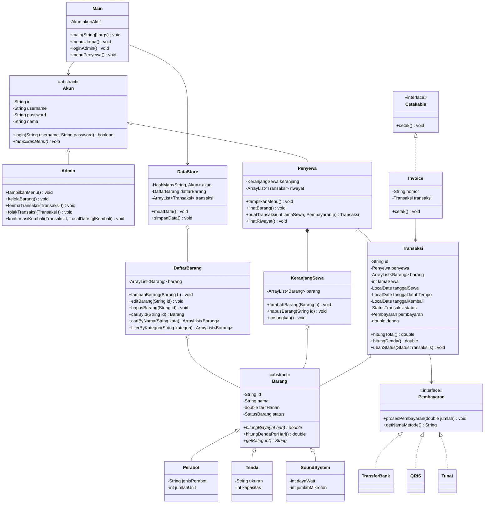

# PRD: Sistem Rental Perlengkapan Acara (EventRent)

| Item | Isi |
|---|---|
| Nama produk | EventRent **[ASUMSI: nama toko baru, boleh diganti]** |
| Judul tugas | Rental Perlengkapan Acara |
| Mata kuliah | Praktikum PBO (UAS) |
| Jenis dokumen | Product Requirements Document (PRD) |
| Status | Draft untuk disetujui kelompok |
| Deadline | 28 November 2026, 11.00 (target kumpul 27 November) |

> **Petunjuk untuk developer dan AI agent:** Dokumen ini adalah satu-satunya acuan pembuatan program. Setiap requirement punya ID (mis. `FR-ADM-03`) yang bisa dirujuk di commit dan Javadoc. Jika ada hal yang tidak tercantum, pilih keputusan paling sederhana yang konsisten dengan dokumen ini, lalu catat di bagian 19.
> Tanda **[ASUMSI]** = keputusan yang belum dikonfirmasi kelompok dan boleh direvisi.

---

## 1. Ringkasan Produk

EventRent adalah aplikasi CLI berbasis Java untuk mengelola penyewaan perlengkapan acara (pernikahan, ulang tahun, seminar, konser kecil, dan sebagainya): perabot (kursi, meja, sofa), tenda/terop, dan sound system. Aplikasi melayani dua peran: **Admin** (mengelola barang dan transaksi) dan **Penyewa** (menyewa barang). Aplikasi menghitung biaya sewa berbeda per kategori barang, mendukung tiga metode pembayaran, menghitung denda keterlambatan per hari, mencetak invoice, dan menyimpan data ke file `.txt`.

**Konsep barang:** setiap barang di sistem adalah **satu paket/set** yang disewa utuh (mis. "Kursi Futura Set 50 Pcs", "Tenda Terop 4x6 m"). Sistem tidak menghitung jumlah unit per barang, jadi cukup satu status (`TERSEDIA`/`DISEWA`) per paket.

### 1.1 Tujuan
1. Memenuhi seluruh requirement soal UAS Praktikum PBO.
2. Menerapkan Abstraction, Inheritance, Polymorphism, Encapsulation, Collection, dan Exception dengan benar.
3. Berjalan stabil (tidak crash) saat didemokan.

### 1.2 Di Luar Cakupan (Non-Goals)
- GUI / web, database, jaringan.
- Stok jumlah unit per barang (barang dimodelkan sebagai paket tunggal).
- Pengantaran/pengambilan barang dan jadwal booking tanggal di masa depan.
- Pembatalan transaksi oleh penyewa, diskon sewa lama, deposit, biaya admin pembayaran.
- Registrasi akun Admin (Admin hanya dari data awal).
- Warna ANSI di CLI.

### 1.3 Identitas Tim
| No | Nama | NIM |
|---|---|---|
| 1 | Muhammad Faris Zufar | 250810701100058 |
| 2 | M. Diral | 250810701100055 |
| 3 | Zaw Then Theit | 250810701100046 |

### 1.4 Keputusan Teknis
| Item | Keputusan |
|---|---|
| Bahasa kode, komentar, pesan CLI | Indonesia |
| Java | Versi LTS terbaru **[ASUMSI: JDK 25]**, tanpa Maven/Gradle |
| Penyimpanan | File `.txt` di folder `data/` |
| Git | Dikerjakan lokal dahulu, push ke GitHub setelah selesai (lihat bagian 16) |

---

## 2. Pengguna (Persona)

| Peran | Deskripsi | Kemampuan utama |
|---|---|---|
| **Admin** | Pemilik/petugas toko EventRent. Satu akun dari data awal. | Kelola barang, terima/tolak transaksi, konfirmasi pengembalian + denda, laporan pendapatan |
| **Penyewa** | Pelanggan penyelenggara acara. Dua akun awal + bisa registrasi sendiri. | Lihat/cari/filter barang, keranjang sewa, checkout, pilih pembayaran, lihat riwayat |

---

## 3. Alur Utama Aplikasi (Menu Utama)

**Menu utama hanya berisi tiga pilihan: Admin, Penyewa, dan Keluar.**

```
=========== EVENTRENT ===========
1. Admin
2. Penyewa
0. Keluar
=================================
Pilih menu:
```

### 3.1 Pilihan 1: Admin
Langsung meminta login Admin (tanpa registrasi).
```
--- LOGIN ADMIN ---
Username: 
Password: 
```
Hanya akun berperan Admin yang diterima. Jika berhasil → **Menu Admin**. Jika akun benar tetapi bukan Admin → `LoginGagalException`.

### 3.2 Pilihan 2: Penyewa
Menampilkan submenu akses Penyewa, karena registrasi diperlukan:
```
--- AKSES PENYEWA ---
1. Login
2. Registrasi akun baru
0. Kembali ke menu utama
```
- **Login**: hanya akun berperan Penyewa yang diterima → **Menu Penyewa**.
- **Registrasi**: membuat akun Penyewa baru, lalu kembali ke submenu ini (pengguna login manual).

### 3.3 Pilihan 0: Keluar
Menyimpan data lalu menghentikan program dengan pesan penutup.

### 3.4 Logout
Logout dari Menu Admin atau Menu Penyewa **kembali ke menu utama** (bagian 3), bukan menutup program.

### 3.5 Batas Percobaan Login
Maksimal **3 kali** salah per sesi login. Setiap kegagalan melempar `LoginGagalException` dan menampilkan sisa percobaan. Setelah gagal ke-3, program **berhenti** setelah menyimpan data. **[ASUMSI]** sesuai keputusan awal "3 kali"; jika lebih baik kembali ke menu utama, cukup diubah di `Main`.

---

## 4. Functional Requirements

### 4.1 Akun dan Autentikasi
| ID | Requirement |
|---|---|
| FR-AKN-01 | Sistem menyediakan login terpisah untuk Admin dan Penyewa dari menu utama |
| FR-AKN-02 | Login memverifikasi username + password dan kesesuaian peran |
| FR-AKN-03 | Maksimal 3 kali gagal login, lalu program berhenti |
| FR-AKN-04 | Registrasi Penyewa: username tidak kosong dan tanpa spasi, unik, password minimal 4 karakter, nama tidak kosong. Gagal → `InputTidakValidException` |
| FR-AKN-05 | Akun disimpan di `HashMap<String, Akun>` (key = username) dan ke `data/akun.txt` |

**Data akun awal (seed):**
| ID | Peran | Username | Password | Nama |
|---|---|---|---|---|
| AKN-001 | Admin | `admin` | `admin123` | Administrator EventRent |
| AKN-002 | Penyewa | `budi` | `budi123` | Budi Santoso |
| AKN-003 | Penyewa | `siti` | `siti123` | Siti Aminah |

### 4.2 Fitur Admin
| ID | Requirement |
|---|---|
| FR-ADM-01 | Tambah barang baru (pilih kategori, isi atribut sesuai kategori, ID otomatis `BRG-xxx`, status awal `TERSEDIA`) |
| FR-ADM-02 | Edit barang (nama, tarif harian, atribut tambahan). Barang berstatus `DISEWA` tidak boleh diedit |
| FR-ADM-03 | Hapus barang. Barang berstatus `DISEWA` tidak boleh dihapus (`BarangTidakTersediaException`) |
| FR-ADM-04 | Lihat daftar barang (tabel), cari berdasarkan nama, filter per kategori |
| FR-ADM-05 | Lihat daftar transaksi berstatus `MENUNGGU` |
| FR-ADM-06 | Terima transaksi: cek ulang ketersediaan semua barang, ubah barang menjadi `DISEWA`, status transaksi `DITERIMA`, set tanggal sewa + jatuh tempo, cetak invoice sewa |
| FR-ADM-07 | Tolak transaksi: status `DITOLAK`, barang tetap `TERSEDIA` |
| FR-ADM-08 | Konfirmasi pengembalian: input tanggal kembali (kosong = hari ini, format `yyyy-MM-dd`), hitung denda, proses pembayaran denda (jika > 0), barang kembali `TERSEDIA`, status `SELESAI`, cetak invoice final |
| FR-ADM-09 | Lihat semua transaksi |
| FR-ADM-10 | Laporan pendapatan (lihat 4.7) |

### 4.3 Fitur Penyewa
| ID | Requirement |
|---|---|
| FR-PNY-01 | Lihat daftar barang (tabel) beserta statusnya |
| FR-PNY-02 | Cari barang berdasarkan nama (contains, tidak peka huruf besar/kecil) |
| FR-PNY-03 | Filter barang per kategori (Perabot / Tenda / Sound System) |
| FR-PNY-04 | Tambah barang ke daftar sewa (keranjang), boleh lebih dari satu. Barang `DISEWA` ditolak; barang duplikat dalam keranjang ditolak |
| FR-PNY-05 | Lihat dan hapus isi daftar sewa |
| FR-PNY-06 | Checkout: input lama sewa (1-30 hari), pilih metode pembayaran, proses pembayaran, buat transaksi `MENUNGGU`, kosongkan keranjang |
| FR-PNY-07 | Riwayat sewa: transaksi `DITERIMA` dan `SELESAI` beserta invoice |
| FR-PNY-08 | Status transaksi saya: semua transaksi (termasuk `MENUNGGU` dan `DITOLAK`) |

### 4.4 Barang, Kategori, dan Perhitungan Biaya
| ID | Requirement |
|---|---|
| FR-BRG-01 | Tiga kategori dengan cara hitung berbeda, dihitung lewat `hitungBiaya(int hari)` yang di-override tiap subclass (polymorphism) |
| FR-BRG-02 | Barang yang sedang `DISEWA` tidak boleh disewa penyewa lain |

| Kategori | Class | Rumus biaya sewa | Atribut tambahan |
|---|---|---|---|
| Perabot (kursi, meja, sofa) | `Perabot` | `tarifHarian * hari` (tarif harian biasa) | `jenisPerabot` (String), `jumlahUnit` (int, isi per paket) |
| Tenda (tenda/terop) | `Tenda` | `(tarifHarian * hari) + 150.000` (biaya pemasangan **tetap, sekali** per barang, tidak dikali hari) | `ukuran` (String, mis. "4x6 m"), `kapasitas` (int, orang) |
| Sound System | `SoundSystem` | `(tarifHarian * hari) + (100.000 * hari)` (biaya teknisi **per hari**) | `dayaWatt` (int), `jumlahMikrofon` (int) |

Tiga rumus sengaja berbeda polanya: tarif biasa, biaya tambahan tetap sekali, dan biaya tambahan per hari. Konstanta (150.000 dan 100.000) disimpan sebagai `private static final` di class masing-masing. Label kategori untuk tampilan/filter: `Perabot`, `Tenda`, `Sound System`.

### 4.5 Transaksi dan Denda
| ID | Requirement |
|---|---|
| FR-TRX-01 | Lama sewa 1-30 hari; di luar rentang → `InputTidakValidException` |
| FR-TRX-02 | `tanggalSewa` = tanggal saat admin menerima; `tanggalJatuhTempo = tanggalSewa + lamaSewa` |
| FR-TRX-03 | Saat checkout, semua barang harus `TERSEDIA`, jika tidak → `BarangTidakTersediaException` |
| FR-TRX-04 | Saat admin menerima, ketersediaan dicek ulang. Jika ada barang sudah `DISEWA` oleh transaksi lain → `BarangTidakTersediaException` dan transaksi tidak diterima (admin menolaknya) |
| FR-TRX-05 | Denda = `hariTerlambat * jumlah(0,5 * tarifHarian tiap barang)`, tanpa biaya pemasangan/teknisi |
| FR-TRX-06 | `hariTerlambat = max(0, ChronoUnit.DAYS.between(tanggalJatuhTempo, tanggalKembali))` |
| FR-TRX-07 | Tanggal kembali tidak boleh sebelum tanggal sewa **[ASUMSI]**; format salah → `InputTidakValidException` |
| FR-TRX-08 | Tidak ada diskon, deposit, maupun pembatalan oleh penyewa |

**Siklus status:**
```
Checkout -> MENUNGGU (barang masih TERSEDIA)
  Admin terima -> DITERIMA (barang -> DISEWA, invoice sewa)
  Admin tolak  -> DITOLAK  (barang tetap TERSEDIA)
DITERIMA -> Admin konfirmasi kembali -> SELESAI (barang -> TERSEDIA, invoice final)
```
Enum: `StatusBarang {TERSEDIA, DISEWA}`, `StatusTransaksi {MENUNGGU, DITERIMA, SELESAI, DITOLAK}`.

### 4.6 Pembayaran
| ID | Requirement |
|---|---|
| FR-BYR-01 | Interface `Pembayaran` dengan `void prosesPembayaran(double jumlah)` dan `String getNamaMetode()` |
| FR-BYR-02 | Tiga implementasi: `TransferBank`, `QRIS`, `Tunai` |
| FR-BYR-03 | Pembayaran biaya sewa diproses saat checkout; denda diproses saat pengembalian dengan metode transaksi yang sama |
| FR-BYR-04 | Tanpa biaya admin |

| Class | Perilaku |
|---|---|
| `TransferBank` | Tampilkan rekening toko (`BCA 1234567890 a.n. EventRent`) dan nominal, minta konfirmasi "sudah transfer" (y/n) |
| `QRIS` | Tampilkan kode QR simulasi (teks) dan nominal, minta konfirmasi "sudah dibayar" (y/n) |
| `Tunai` | Minta uang diterima; kurang → `InputTidakValidException`; lebih → tampilkan kembalian |

### 4.7 Invoice dan Laporan
| ID | Requirement |
|---|---|
| FR-INV-01 | Invoice dicetak dua kali: saat transaksi diterima dan saat pengembalian (final dengan denda) |
| FR-INV-02 | Isi: header EventRent, nomor `INV-xxx`, tanggal cetak, data penyewa, rincian barang (ID, nama, kategori, tarif/hari, biaya), lama sewa, tanggal sewa, jatuh tempo, tanggal kembali, metode bayar, total sewa, denda, total keseluruhan |
| FR-INV-03 | Format tabel dengan `printf`, rupiah berformat `Rp2.025.000` |
| FR-LAP-01 | Laporan pendapatan dari transaksi `SELESAI`: total sewa, total denda, total keseluruhan, jumlah transaksi, rincian **per kategori barang** dan **per metode pembayaran** |

### 4.7a Penyimpanan Data
| ID | Requirement |
|---|---|
| FR-DAT-01 | Data akun, barang, dan transaksi disimpan ke `data/akun.txt`, `data/barang.txt`, `data/transaksi.txt` |
| FR-DAT-02 | Saat start, data dimuat; jika file belum ada, dibuat dari data seed |
| FR-DAT-03 | Data disimpan setiap ada perubahan dan saat keluar |
| FR-DAT-04 | Counter ID diset dari ID terbesar yang ada setelah data dimuat |

**Format file [ASUMSI]:** satu record per baris, pemisah `|`, baris berawalan `#` diabaikan.
```
akun.txt      : id|peran|username|password|nama
barang.txt    : id|kategori|nama|tarifHarian|status|atribut1|atribut2
transaksi.txt : id|idPenyewa|idBarang1;idBarang2|lamaSewa|tglSewa|tglJatuhTempo|tglKembali|status|metode|denda|nomorInvoice
```
Tanggal `yyyy-MM-dd` (kosong jika belum ada). Kategori di file: `PERABOT`, `TENDA`, `SOUNDSYSTEM`. Perabot memakai `jenisPerabot|jumlahUnit`, Tenda `ukuran|kapasitas`, Sound System `dayaWatt|jumlahMikrofon`. Relasi transaksi ke Penyewa dan Barang dipulihkan lewat ID.

### 4.8 Pencarian, Tampilan, dan Format
| ID | Requirement |
|---|---|
| FR-UI-01 | Daftar barang dan transaksi ditampilkan dalam tabel (ID, Nama, Kategori, Tarif/Hari, Status) |
| FR-UI-02 | Format ID: `BRG-001`, `TRX-001`, `INV-001`, `AKN-001` |
| FR-UI-03 | Input menu memakai `Scanner.nextLine()` lalu di-parse; kesalahan input tidak membuat program crash, cukup pesan error dan ulangi menu |

---

## 5. Menu Setelah Login

### 5.1 Menu Admin
```
1. Kelola barang (tambah / edit / hapus / lihat)
2. Cari barang / filter kategori
3. Transaksi menunggu -> terima / tolak
4. Transaksi disewa -> konfirmasi pengembalian
5. Lihat semua transaksi
6. Laporan pendapatan
0. Logout (kembali ke menu utama)
```

### 5.2 Menu Penyewa
```
1. Lihat daftar barang
2. Cari barang (nama)
3. Filter barang per kategori
4. Tambah barang ke daftar sewa
5. Lihat / hapus isi daftar sewa
6. Checkout
7. Riwayat sewa
8. Status transaksi saya
0. Logout (kembali ke menu utama)
```

---

## 6. Data Seed Barang

| ID | Kategori | Nama | Tarif/hari (Rp) | Atribut |
|---|---|---|---|---|
| BRG-001 | Perabot | Kursi Futura Set 50 Pcs | 75.000 | Kursi, 50 |
| BRG-002 | Perabot | Kursi Chiavari Set 20 Pcs | 100.000 | Kursi, 20 |
| BRG-003 | Perabot | Meja Bundar Set 10 Pcs | 60.000 | Meja, 10 |
| BRG-004 | Perabot | Sofa Tamu Set | 120.000 | Sofa, 1 |
| BRG-005 | Tenda | Tenda Terop 4x6 m | 200.000 | 4x6 m, 20 orang |
| BRG-006 | Tenda | Tenda Terop 6x12 m | 400.000 | 6x12 m, 60 orang |
| BRG-007 | Tenda | Tenda Sarnafil 10x15 m | 800.000 | 10x15 m, 150 orang |
| BRG-008 | Sound System | Sound System Kecil 500 Watt | 250.000 | 500 W, 2 mic |
| BRG-009 | Sound System | Sound System Sedang 1000 Watt | 450.000 | 1000 W, 4 mic |
| BRG-010 | Sound System | Sound System Panggung 2000 Watt | 750.000 | 2000 W, 6 mic |

Semua berstatus awal `TERSEDIA`.

**Contoh hitung (untuk uji):** sewa 3 hari Kursi Futura Set 50 Pcs + Tenda Terop 4x6 m + Sound System Kecil 500 Watt:
- Kursi Futura: 75.000 × 3 = **225.000**
- Tenda 4x6: (200.000 × 3) + 150.000 (pemasangan) = 600.000 + 150.000 = **750.000**
- Sound Kecil: (250.000 × 3) + (100.000 × 3) (teknisi) = 750.000 + 300.000 = **1.050.000**
- **Total = 2.025.000**
- Terlambat 2 hari: denda per hari = 0,5 × (75.000 + 200.000 + 250.000) = 262.500; denda = 2 × 262.500 = **525.000**

---

## 7. Arsitektur dan Class Diagram



### 7.1 Struktur Folder
```
EventRent/
├── README.md
├── PRD_EventRent.md
├── data/                      (dibuat otomatis)
│   ├── akun.txt  barang.txt  transaksi.txt
├── docs/
│   └── class-diagram.png
└── src/
    ├── Main.java
    ├── model/       Akun, Admin, Penyewa, Barang, Perabot, Tenda, SoundSystem, StatusBarang, StatusTransaksi
    ├── pembayaran/  Pembayaran, TransferBank, QRIS, Tunai
    ├── transaksi/   Transaksi, Invoice, KeranjangSewa, Cetakable
    ├── exception/   LoginGagalException, BarangTidakTersediaException,
    │                BarangTidakDitemukanException, InputTidakValidException
    ├── data/        DataStore, DaftarBarang
    └── util/        IdGenerator, TabelCetak, InputHelper
```
Semua custom exception mewarisi `Exception` (checked) **[ASUMSI]**.

### 7.2 Tanggung Jawab Class (ringkas)
- **Akun**: atribut `private` + getter/setter bervalidasi; `login()`; `tampilkanMenu()` abstract.
- **Admin / Penyewa**: perilaku sesuai bagian 4.2 dan 4.3.
- **Barang**: abstract; `hitungBiaya()` dan `getKategori()` abstract; `hitungDendaPerHari()` = `tarifHarian * 0.5` (konkret); setter tarif menolak nilai ≤ 0.
- **Perabot / Tenda / SoundSystem**: override `hitungBiaya()` sesuai bagian 4.4; atribut tambahan `private` dengan validasi (nilai > 0).
- **DaftarBarang**: `cariById` melempar `BarangTidakDitemukanException` jika tidak ada.
- **Transaksi**: `hitungTotal()`, `hitungDenda()`, `ubahStatus()`.
- **Invoice** implements `Cetakable`.
- **DataStore**: `muatData()`, `simpanData()`, seed data.
- **Main**: hanya alur menu utama (Admin / Penyewa / Keluar) dan pemanggilan login; logika bisnis berada di class domain.

---

## 8. Penerapan Konsep OOP (untuk dijelaskan saat demo)

| Konsep | Penerapan |
|---|---|
| Abstraction | `Akun`, `Barang` (abstract); interface `Pembayaran`, `Cetakable` |
| Inheritance | `Admin`/`Penyewa` ← `Akun`; `Perabot`/`Tenda`/`SoundSystem` ← `Barang` |
| Polymorphism | `hitungBiaya()` via tipe `Barang`; `prosesPembayaran()` via tipe `Pembayaran`; `tampilkanMenu()` via tipe `Akun` |
| Encapsulation | Semua atribut `private`, akses lewat getter/setter dengan validasi |
| Collection | `ArrayList<Barang>`, `ArrayList<Transaksi>`, `HashMap<String, Akun>` |
| Exception | 4 custom exception + penanganan kesalahan input |

---

## 9. Non-Functional Requirements

| ID | Requirement |
|---|---|
| NFR-01 | Program tidak boleh crash karena input pengguna |
| NFR-02 | Javadoc wajib di setiap class dan method `public` (`@param`, `@return`, `@throws`), ditulis bersamaan dengan kode |
| NFR-03 | Penamaan: class `PascalCase`, method/variabel `camelCase`, konstanta `UPPER_SNAKE_CASE`, Bahasa Indonesia |
| NFR-04 | Satu class per file; tanggal memakai `LocalDate` dan `ChronoUnit` |
| NFR-05 | `System.exit()` hanya dipakai untuk Keluar dan setelah 3 kali gagal login |
| NFR-06 | Dapat di-compile dan dijalankan hanya dengan JDK |

Perintah (dari root proyek):
```
javac -d out -sourcepath src src/Main.java
java -cp out Main
javadoc -d docs/javadoc -sourcepath src -subpackages model:pembayaran:transaksi:exception:data:util
```

---

## 10. Penanganan Exception

| Exception | Dilempar saat |
|---|---|
| `LoginGagalException` | Username/password salah atau peran tidak sesuai |
| `BarangTidakTersediaException` | Barang `DISEWA` dimasukkan keranjang/checkout/diterima; hapus/edit barang `DISEWA` |
| `BarangTidakDitemukanException` | ID barang tidak ada |
| `InputTidakValidException` | Input kosong, format salah, lama sewa di luar 1-30, username duplikat, uang tunai kurang, tanggal salah |

Selain itu tangani `InputMismatchException` dan `NumberFormatException` pada pembacaan input.

---

## 11. Skenario Uji dan Acceptance Criteria

| No | Skenario | Hasil yang diharapkan |
|---|---|---|
| 1 | Menu utama | Hanya tampil Admin, Penyewa, Keluar |
| 2 | Login Admin benar / salah | Benar → Menu Admin; salah → pesan dan sisa percobaan |
| 3 | Login Penyewa dengan akun admin (peran salah) | Ditolak |
| 4 | Gagal login 3 kali | Program berhenti setelah data tersimpan |
| 5 | Registrasi baru / username duplikat | Baru berhasil dan bisa login; duplikat ditolak |
| 6 | Budi sewa Kursi Futura + Tenda 4x6 + Sound Kecil, 3 hari, QRIS | Total 2.025.000, transaksi `MENUNGGU` |
| 7 | Admin terima transaksi Budi | Barang `DISEWA`, invoice tercetak, masuk riwayat Budi |
| 8 | Siti menambah Tenda 4x6 yang `DISEWA` | `BarangTidakTersediaException` |
| 9 | Dua transaksi `MENUNGGU` untuk barang sama, admin terima keduanya berurutan | Yang pertama diterima, yang kedua gagal dengan exception |
| 10 | Admin tolak transaksi | `DITOLAK`, barang tetap `TERSEDIA` |
| 11 | Pengembalian terlambat 2 hari | Denda 525.000 (contoh bagian 6), invoice final, `SELESAI`, barang `TERSEDIA` |
| 12 | Pengembalian tepat waktu | Denda 0 |
| 13 | Barang yang sudah kembali disewa lagi | Berhasil |
| 14 | Admin tambah/edit/hapus barang; hapus barang `DISEWA` | CRUD berhasil; hapus barang disewa ditolak |
| 15 | Cari "tenda" dan filter kategori Sound System | Hasil sesuai |
| 16 | Laporan pendapatan | Angka sesuai transaksi `SELESAI` |
| 17 | Input ngawur (huruf, negatif, kosong, lama sewa 0 / 31) | Pesan error, tidak crash |
| 18 | Logout lalu pilih peran lain | Kembali ke menu utama, bisa login peran lain |
| 19 | Tutup lalu jalankan ulang | Data akun, barang, transaksi tetap ada |
| 20 | Tunai kurang / lebih bayar | Kurang ditolak; lebih tampil kembalian |

### Definition of Done
- [ ] Semua FR dan skenario uji di atas lolos
- [ ] Javadoc lengkap, tanpa error saat `javadoc`
- [ ] Checklist penilaian terpenuhi (bagian 12)
- [ ] Kode ada di GitHub dengan commit dari ketiga anggota, README lengkap
- [ ] ZIP siap (source code, `.txt` link GitHub, screenshot class diagram)

---

## 12. Checklist Kriteria Penilaian

- [ ] Abstraction, Polymorphism, Inheritance, Encapsulation dengan benar (10)
- [ ] Abstract class dan interface (10)
- [ ] Collection (5)
- [ ] Exception (5)
- [ ] Javadoc dan kontribusi GitHub (20)
- [ ] Demo lancar tanpa PPT (50)

---

## 13. Pembagian Tugas **[ASUMSI]**

| Anggota | Tanggung jawab |
|---|---|
| **Muhammad Faris Zufar** | `Akun`, `Admin`, `Penyewa`, login/registrasi, `Main` (menu utama + menu Admin/Penyewa), `InputHelper`, integrasi akhir |
| **M. Diral** | `Barang`, `Perabot`, `Tenda`, `SoundSystem`, `DaftarBarang`, `KeranjangSewa`, `DataStore`, `IdGenerator`, enum |
| **Zaw Then Theit** | `Pembayaran` + 3 implementasi, `Transaksi`, `Invoice`, `Cetakable`, `TabelCetak`, laporan pendapatan |
| **Bersama** | 4 custom exception (Faris: Login & InputTidakValid; Diral: BarangTidakTersedia & BarangTidakDitemukan), Javadoc, README, class diagram, pengujian silang, latihan demo |

Setiap anggota harus bisa menjelaskan semua kode miliknya.

---

## 14. Timeline

| Tanggal | Fokus |
|---|---|
| 18-19 Nov | Setujui PRD, setup folder, class diagram final |
| 19-20 Nov | Fondasi: enum, exception, interface, abstract class |
| 20-24 Nov | Implementasi paralel sesuai pembagian |
| 24-25 Nov | Integrasi `Main`, menu, seed, penyimpanan `.txt` |
| 25-26 Nov | Pengujian (bagian 11), perbaikan, Javadoc final |
| 26 Nov | Push ke GitHub, README, screenshot class diagram, susun ZIP |
| 27 Nov | Pengumpulan + latihan demo |
| 28 Nov 11.00 | Deadline mutlak |

---

## 15. Alur Demo (50 poin)

1. Menu utama → **2 Penyewa** → Login `budi` → cari "tenda", filter Sound System.
2. Tambah Kursi Futura Set 50 Pcs, Tenda Terop 4x6 m, Sound System Kecil 500 Watt → checkout 3 hari → QRIS.
3. Logout → menu utama → **1 Admin** → login `admin` → terima transaksi Budi (invoice tercetak).
4. Logout → **2 Penyewa** → login `siti` → coba sewa Tenda Terop 4x6 m → ditolak (exception).
5. Login `admin` → konfirmasi pengembalian dengan tanggal terlambat → denda + invoice final.
6. Login `budi` → riwayat sewa.
7. Admin: tambah, edit, hapus barang, lalu laporan pendapatan.
8. **0 Keluar**, jalankan lagi → data tetap ada.

---

## 16. Konvensi Git

- Pengembangan lokal dulu, push ke GitHub setelah selesai. **Agar kontribusi (20 poin) terlihat:** tiap anggota commit dengan `git config user.name` / `user.email` miliknya sendiri, commit sejak awal secara bertahap, dan sebelum push akhir gabungkan pekerjaan semua anggota (merge/pull atau push branch masing-masing) sehingga commit ketiganya muncul di GitHub.
- Branch: `main`, `feature/nama-fitur` (mis. `feature/akun-login`, `feature/barang`, `feature/transaksi-pembayaran`).
- Pesan commit: `feat: ...`, `fix: ...`, `docs: ...`, `refactor: ...`.
- `.gitignore`: `out/`, `*.class`, folder IDE. Folder `data/` disertakan dengan data seed **[ASUMSI]**.
- Anggota yang tidak berkontribusi dicoret dari README.

## 17. Kerangka README.md

```markdown
# Rental Perlengkapan Acara (EventRent)

Sistem penyewaan perlengkapan acara (perabot, tenda, dan sound system) berbasis CLI menggunakan Java.
Mendukung peran Admin dan Penyewa, tiga kategori barang dengan perhitungan biaya berbeda,
tiga metode pembayaran, denda keterlambatan, dan penyimpanan data ke file.

## Anggota
- Muhammad Faris Zufar (250810701100058)
- M. Diral (250810701100055)
- Zaw Then Theit (250810701100046)

## Cara Menjalankan
(perintah compile & run)

## Akun Demo
admin / admin123, budi / budi123, siti / siti123
```

## 18. Isi ZIP Pengumpulan
1. Source code
2. File `.txt` berisi link GitHub
3. Screenshot class diagram

## 19. Catatan Keputusan Baru
*(Format: tanggal, keputusan, alasan.)*

- 2026-11-21: Tema diubah dari rental kamera (FotoRent) menjadi rental perlengkapan acara (EventRent). Kategori diganti menjadi Perabot, Tenda, dan Sound System.
