# Class Diagram: EventRent (Sistem Rental Perlengkapan Acara)

Diagram kelas berikut disusun berdasarkan struktur source code Java aktual pada proyek **EventRent** dan selaras dengan diagram visual pada `docs/class-diagram.png`. Diagram ini memvisualisasikan penerapan lima pilar Pemrograman Berorientasi Objek (PBO): **Abstraction, Encapsulation, Inheritance, Polymorphism, dan Interface**, beserta kelas utilitas dan custom exception.

```mermaid
classDiagram
    direction TB

    %% ========================================================
    %% 1. HIERARKI AKUN & PENGGUNA (Inheritance & Abstraction)
    %% ========================================================
    class Akun {
        <<abstract>>
        -String id
        -String username
        -String password
        -String nama
        +login(String inputUser, String inputPass) boolean
        +tampilkanMenu()* void
        +getPeran()* String
        +getId() String
        +setId(String id) void
        +getUsername() String
        +setUsername(String username) void
        +getPassword() String
        +setPassword(String password) void
        +getNama() String
        +setNama(String nama) void
    }

    class Admin {
        -DataStore dataStore
        +getPeran() String
        +tampilkanMenu() void
        +kelolaBarang() void
        +terimaTransaksi(Transaksi t) void
        +tolakTransaksi(Transaksi t) void
        +konfirmasiKembali(Transaksi t, LocalDate tglKembali) void
    }

    class Penyewa {
        -KeranjangSewa keranjang
        -ArrayList~Transaksi~ riwayat
        -DataStore dataStore
        +getPeran() String
        +tampilkanMenu() void
        +lihatBarang() void
        +buatTransaksi(int lamaSewa, Pembayaran p) Transaksi
        +lihatRiwayat() void
        +lihatStatusTransaksi() void
        +tambahRiwayat(Transaksi t) void
        +getKeranjang() KeranjangSewa
        +getRiwayat() ArrayList~Transaksi~
    }

    Akun <|-- Admin : extends
    Akun <|-- Penyewa : extends

    %% ========================================================
    %% 2. HIERARKI BARANG & KATALOG (Polymorphism & Abstraction)
    %% ========================================================
    class StatusBarang {
        <<enumeration>>
        TERSEDIA
        DISEWA
    }

    class Barang {
        <<abstract>>
        -String id
        -String nama
        -double tarifHarian
        -StatusBarang status
        +hitungBiaya(int hari)* double
        +hitungDendaPerHari() double
        +getKategori()* String
        +getAtribut1()* String
        +getAtribut2()* String
        +isTersedia() boolean
        +getId() String
        +setId(String id) void
        +getNama() String
        +setNama(String nama) void
        +getTarifHarian() double
        +setTarifHarian(double tarifHarian) void
        +getStatus() StatusBarang
        +setStatus(StatusBarang status) void
    }

    class Perabot {
        -String jenisPerabot
        -int jumlahUnit
        +hitungBiaya(int hari) double
        +getKategori() String
        +getAtribut1() String
        +getAtribut2() String
        +getJenisPerabot() String
        +setJenisPerabot(String jenisPerabot) void
        +getJumlahUnit() int
        +setJumlahUnit(int jumlahUnit) void
    }

    class Tenda {
        -double BIAYA_PEMASANGAN$
        -String ukuran
        -int kapasitas
        +hitungBiaya(int hari) double
        +getKategori() String
        +getAtribut1() String
        +getAtribut2() String
        +getBiayaPemasangan()$ double
        +getUkuran() String
        +setUkuran(String ukuran) void
        +getKapasitas() int
        +setKapasitas(int kapasitas) void
    }

    class SoundSystem {
        -double BIAYA_TEKNISI_PER_HARI$
        -int dayaWatt
        -int jumlahMikrofon
        +hitungBiaya(int hari) double
        +getKategori() String
        +getAtribut1() String
        +getAtribut2() String
        +getBiayaTeknisiPerHari()$ double
        +getDayaWatt() int
        +setDayaWatt(int dayaWatt) void
        +getJumlahMikrofon() int
        +setJumlahMikrofon(int jumlahMikrofon) void
    }

    Barang <|-- Perabot : extends
    Barang <|-- Tenda : extends
    Barang <|-- SoundSystem : extends
    Barang --> "1" StatusBarang : status

    class DaftarBarang {
        -ArrayList~Barang~ barangList
        +tambahBarang(Barang b) void
        +hapusBarang(String id) void
        +cariById(String id) Barang
        +cariByNama(String kata) ArrayList~Barang~
        +filterByKategori(String kategori) ArrayList~Barang~
        +getSemuaBarang() ArrayList~Barang~
        +getBarangTersedia() ArrayList~Barang~
        +kosongkan() void
        +jumlahBarang() int
    }

    DaftarBarang "1" o-- "*" Barang : agregasi

    %% ========================================================
    %% 3. HIERARKI PEMBAYARAN (Interface Realization)
    %% ========================================================
    class Pembayaran {
        <<interface>>
        +prosesPembayaran(double jumlah)* void
        +getNamaMetode()* String
    }

    class TransferBank {
        -String REKENING_TOKO$
        +prosesPembayaran(double jumlah) void
        +getNamaMetode() String
    }

    class QRIS {
        +prosesPembayaran(double jumlah) void
        +getNamaMetode() String
    }

    class Tunai {
        +prosesPembayaran(double jumlah) void
        +getNamaMetode() String
    }

    Pembayaran <|.. TransferBank : implements
    Pembayaran <|.. QRIS : implements
    Pembayaran <|.. Tunai : implements

    %% ========================================================
    %% 4. TRANSAKSI, KERANJANG, & INVOICE
    %% ========================================================
    class StatusTransaksi {
        <<enumeration>>
        MENUNGGU
        DITERIMA
        SELESAI
        DITOLAK
    }

    class Cetakable {
        <<interface>>
        +cetak()* void
    }

    class KeranjangSewa {
        -ArrayList~Barang~ daftarBarang
        +tambahBarang(Barang b) void
        +hapusBarang(String id) void
        +kosongkan() void
        +isKosong() boolean
        +getBarang() ArrayList~Barang~
        +hitungTotal(int hari) double
        +jumlahBarang() int
    }

    KeranjangSewa "1" o-- "*" Barang : agregasi
    Penyewa "1" *-- "1" KeranjangSewa : komposisi

    class Transaksi {
        -String id
        -Penyewa penyewa
        -ArrayList~Barang~ barang
        -int lamaSewa
        -LocalDate tanggalSewa
        -LocalDate tanggalJatuhTempo
        -LocalDate tanggalKembali
        -StatusTransaksi status
        -Pembayaran pembayaran
        -double denda
        -String nomorInvoice
        +hitungTotal() double
        +hitungHariTerlambat() int
        +hitungDenda() double
        +ubahStatus(StatusTransaksi s) void
        +getId() String
        +getPenyewa() Penyewa
        +setPenyewa(Penyewa penyewa) void
        +getBarang() ArrayList~Barang~
        +getLamaSewa() int
        +setLamaSewa(int lamaSewa) void
        +getTanggalSewa() LocalDate
        +setTanggalSewa(LocalDate tanggalSewa) void
        +getTanggalJatuhTempo() LocalDate
        +setTanggalJatuhTempo(LocalDate tanggalJatuhTempo) void
        +getTanggalKembali() LocalDate
        +setTanggalKembali(LocalDate tanggalKembali) void
        +getStatus() StatusTransaksi
        +setStatus(StatusTransaksi status) void
        +getPembayaran() Pembayaran
        +setPembayaran(Pembayaran pembayaran) void
        +getDenda() double
        +setDenda(double denda) void
        +getNomorInvoice() String
        +setNomorInvoice(String nomorInvoice) void
    }

    Transaksi --> "1" Penyewa : penyewa
    Transaksi "1" o-- "*" Barang : items
    Transaksi --> "1" Pembayaran : metode
    Transaksi --> "1" StatusTransaksi : status
    Penyewa "1" o-- "*" Transaksi : riwayat

    class Invoice {
        -String nomor
        -Transaksi transaksi
        +cetak() void
        +getNomor() String
        +setNomor(String nomor) void
        +getTransaksi() Transaksi
        +setTransaksi(Transaksi transaksi) void
    }

    Cetakable <|.. Invoice : implements
    Invoice --> "1" Transaksi : mencetak

    %% ========================================================
    %% 5. PERSISTENSI DATA & APLIKASI UTAMA
    %% ========================================================
    class DataStore {
        -String FOLDER_DATA$
        -String FILE_AKUN$
        -String FILE_BARANG$
        -String FILE_TRANSAKSI$
        -HashMap~String, Akun~ akun
        -HashMap~String, Akun~ akunById
        -DaftarBarang daftarBarang
        -ArrayList~Transaksi~ transaksi
        +muatData() void
        +simpanData() void
        +cariAkun(String username) Akun
        +cariAkunById(String id) Akun
        +tambahAkun(Akun a) void
        +simpanAkun() void
        +simpanBarang() void
        +getDaftarBarang() DaftarBarang
        +simpanTransaksi() void
        +tambahTransaksi(Transaksi t) void
        +getSemuaTransaksi() ArrayList~Transaksi~
        +getTransaksiMenunggu() ArrayList~Transaksi~
        +getTransaksiDisewa() ArrayList~Transaksi~
        +cariTransaksi(String id) Transaksi
    }

    DataStore "1" o-- "*" Akun : kelola akun
    DataStore "1" *-- "1" DaftarBarang : katalog
    DataStore "1" o-- "*" Transaksi : rekaman
    Admin --> "1" DataStore : mengelola
    Penyewa --> "1" DataStore : mengakses

    class Main {
        -DataStore dataStore$
        -Akun akunAktif$
        +main(String[] args)$ void
        +menuUtama()$ void
        +loginAdmin()$ void
        +menuPenyewa()$ void
    }

    Main --> "1" DataStore : inisialisasi
    Main --> "0..1" Akun : sesi aktif

    %% ========================================================
    %% 6. UTILITAS & HELPER
    %% ========================================================
    class IdGenerator {
        -int counterAkun$
        -int counterBarang$
        -int counterTransaksi$
        -int counterInvoice$
        +generateIdAkun()$ String
        +generateIdBarang()$ String
        +generateIdTransaksi()$ String
        +generateNomorInvoice()$ String
        +updateCounterAkun(String id)$ void
        +updateCounterBarang(String id)$ void
        +updateCounterTransaksi(String id)$ void
        +updateCounterInvoice(String nomor)$ void
    }

    class InputHelper {
        -Scanner scanner$
        -DateTimeFormatter FORMAT_TANGGAL$
        -Locale LOCALE_ID$
        +setScanner(Scanner s)$ void
        +bacaString(String prompt)$ String
        +bacaStringWajib(String prompt)$ String
        +bacaStringAman(String prompt)$ String
        +bacaInteger(String prompt, int min, int max)$ int
        +bacaDouble(String prompt, double min, double max)$ double
        +bacaKonfirmasi(String prompt)$ boolean
        +bacaTanggal(String prompt, LocalDate defaultTanggal)$ LocalDate
        +tungguEnter()$ void
        +formatRupiah(double nominal)$ String
        +cetakGaris(char karakter, int panjang)$ void
        +cetakHeader(String judul)$ void
    }

    class TabelCetak {
        +cetakTabelBarang(List~String[]~ dataBarang)$ void
        +potongTeks(String teks, int maxPanjang)$ String
    }

    Main ..> InputHelper : menggunakan
    Main ..> IdGenerator : menggunakan
    Admin ..> InputHelper : menggunakan
    Admin ..> IdGenerator : menggunakan
    Penyewa ..> InputHelper : menggunakan
    Penyewa ..> IdGenerator : menggunakan
    DataStore ..> IdGenerator : menggunakan
    TransferBank ..> InputHelper : menggunakan
    QRIS ..> InputHelper : menggunakan
    Tunai ..> InputHelper : menggunakan
    Invoice ..> InputHelper : menggunakan

    %% ========================================================
    %% 7. CUSTOM EXCEPTIONS
    %% ========================================================
    class Exception {
        <<Java Standard>>
    }

    class LoginGagalException {
        +LoginGagalException(String message)
        +LoginGagalException(String message, Throwable cause)
    }

    class BarangTidakTersediaException {
        +BarangTidakTersediaException(String message)
        +BarangTidakTersediaException(String message, Throwable cause)
    }

    class BarangTidakDitemukanException {
        +BarangTidakDitemukanException(String message)
        +BarangTidakDitemukanException(String message, Throwable cause)
    }

    class InputTidakValidException {
        +InputTidakValidException(String message)
        +InputTidakValidException(String message, Throwable cause)
    }

    Exception <|-- LoginGagalException : extends
    Exception <|-- BarangTidakTersediaException : extends
    Exception <|-- BarangTidakDitemukanException : extends
    Exception <|-- InputTidakValidException : extends

    Main ..> LoginGagalException : throws/catch
    Main ..> InputTidakValidException : throws/catch
    Akun ..> InputTidakValidException : throws
    Barang ..> InputTidakValidException : throws
    KeranjangSewa ..> BarangTidakTersediaException : throws
    KeranjangSewa ..> BarangTidakDitemukanException : throws
    KeranjangSewa ..> InputTidakValidException : throws
    DaftarBarang ..> BarangTidakTersediaException : throws
    DaftarBarang ..> BarangTidakDitemukanException : throws
    DaftarBarang ..> InputTidakValidException : throws
    Transaksi ..> InputTidakValidException : throws
    Pembayaran ..> InputTidakValidException : throws
```

